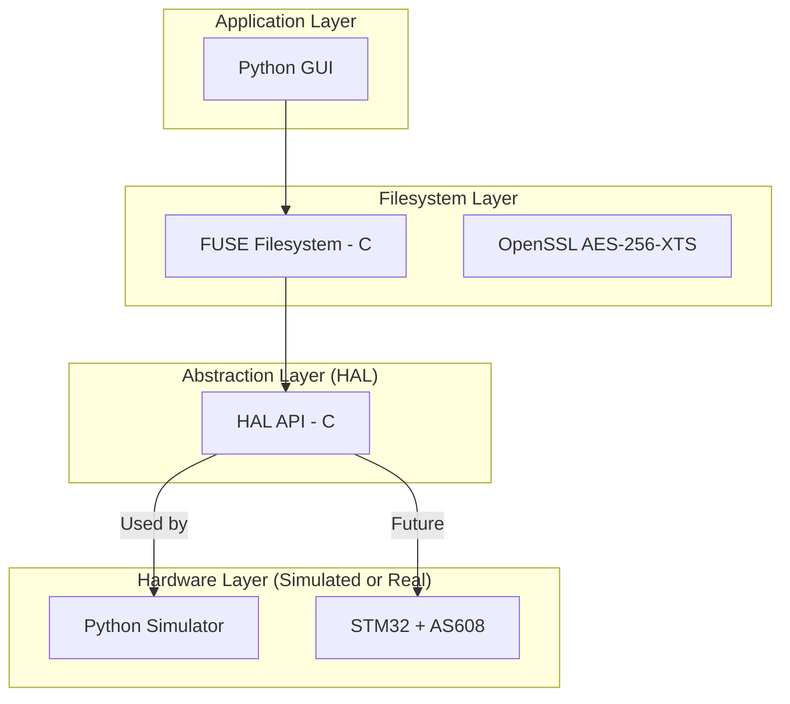

# 🛠 Biometric Vault — Geliştirme Günlüğü & Mimari

Bu doküman, projenin adım adım nasıl inşa edildiğini ve katmanlar arasındaki ilişkiyi açıklar.

---

## 🏗 Genel Mimari

Sistem, donanım bağımlılığını minimize etmek için **Katmanlı Mimari (Layered Architecture)** prensibiyle tasarlanmıştır.



---

## 🟢 Faz 1: Hardware Simulator (Donanım Simülatörü)

Donanım bileşenleri (STM32F103 ve AS608) henüz elde değilken sistemi geliştirebilmek için oluşturulan "Sanal Donanım" katmanıdır.

### Sorumluluklar
- **Key Management:** STM32 içindeki AES-256 anahtarını simüle eder. Cihaz "bağlı" ise anahtar hafızadadır, "çekilirse" (kablosu çıkarılırsa) anahtar yok edilir.
- **Fingerprint DB:** AS608 sensörünün içindeki parmak izi veritabanını simüle eder (Kayıt, Silme, Listeleme).
- **Communication:** Host bilgisayar ile **Unix Domain Socket** üzerinden JSON mesajları ile konuşur.

### Kritik Dosyalar
- `hw_simulator/simulator.py`: Ana daemon süreci. İstekleri kabul eder ve donanım mantığını yürütür.
- `hw_simulator/cli.py`: Simülatörü manuel olarak test etmek için kullanılan terminal aracı.

---

## 🔵 Faz 2: Hardware Abstraction Layer - HAL (Donanım Soyutlama)

FUSE (Dosya sistemi) katmanının donanım detaylarından (kablolar, protokoller, çipler) arındırılmasını sağlayan C kütüphanesidir.

### Neler Sağlıyor?
1.  **Tek Tip API:** Üst katmanlar sadece `hal.h` dosyasındaki temiz C fonksiyonlarını bilir (örn: `hal_verify_finger()`).
2.  **Transparan Geçiş:** Yarın gerçek donanım takıldığında sadece HAL'ın içindeki backend kodu değişir. Sistem geri kalanı (FUSE, GUI) tek bir satır kod değiştirmeden çalışmaya devam eder.
3.  **Hata Yönetimi:** Donanım seviyesindeki karmaşık durumları standart C hata kodlarına çevirir.

### Teknik Detaylar
- **JSON Parsing:** C dünyasında Python simülatörüyle konuşabilmek için `cJSON` kütüphanesi kullanılır.
- **Base64 Decoding:** Simülatörden gelen anahtar güvenli iletim için Base64 formatındadır, HAL bunu OpenSSL kullanarak 32-byte binary veriye çevirir.

---

## 🟣 Faz 3: FUSE Encrypted Filesystem & Crypto

Projenin "kalbi" olan bu katman, verilerin disk üzerinde şifreli olarak saklanmasını ve şifrelerin gerçek zamanlı olarak çözülmesini sağlar.

### 1. Kriptografi Mimarisi (`crypto.c`)
- **Algoritma:** AES-256-XTS (Disk şifreleme için endüstri standardı).
- **Key Derivation (HKDF):** HAL'dan gelen 32-byte anahtar, HKDF kullanılarak 64-byte'lık XTS anahtarına (iki ayrı AES anahtarı) dönüştürülür.
- **Tweak (Sektör Numarası):** Her 4KB'lık blok, disk üzerindeki konumu (sektör numarası) kullanılarak şifrelenir. Bu, aynı verinin farklı sektörlerde farklı görünmesini sağlar.

### 2. Filesystem Metadata (`fs_metadata.h`)
- **Superblock:** Dosya sisteminin "imzası" (Magic Number: `BVLT`) ve genel boyut bilgilerini saklar.
- **Inode Table:** Dosya isimleri, boyutları ve verinin başladığı blok numaraları gibi metadata bilgilerini tutar.
- **Flat Layout:** Basitlik için başlangıç aşamasında tüm dosyalar root dizininde listelenir.

### 3. FUSE Glue Layer (`vault_fs.c`)
- **Lifecycle:** `vault_init` sırasında donanıma bağlanır ve parmak izi doğrulaması zorunlu tutulur. Doğrulama olmadan şifreleme anahtarı yüklenmez ve filesystem mount edilmez.
- **VFS Interface:** Linux çekirdeğinden gelen dosya sistemi isteklerini (readdir, getattr vb.) bizim Block I/O katmanımıza tercüme eder.

---

## 📂 Dosya Yapısı

```text
grad/
├── project_context.md          # Proje vizyonu ve gereksinimler
├── DEVELOPMENT.md             # (Bu dosya) Teknik mimari rehberi
├── hw_simulator/               # FAZ 1: Sanal Donanım (Python)
│   ├── simulator.py            # "Sanal STM32"
│   └── ...
├── hal/                        # FAZ 2: Donanım Soyutlama (C)
│   ├── hal.h                   # Ana API
│   └── ...
└── fuse_vault/                 # FAZ 3: Dosya Sistemi & Şifreleme (C)
    ├── crypto.c                # AES-256-XTS motoru
    ├── block_io.c              # Şifreli disk erişim katmanı
    ├── fs_metadata.h           # Dosya sistemi iç yapısı (Superblock/Inode)
    ├── vault_fs.c              # Ana FUSE implementasyonu
    └── Makefile                # Build sistemi
```

---

## 🛠 Çalıştırma ve Test

Sistemi test etmek için üç ana bileşenin aynı anda çalışması gerekir:

1. **Simülatörü Başlat:**
   ```bash
   cd hw_simulator && python3 simulator.py -v
   ```

2. **FUSE Vault'u Mount Et:**
   ```bash
   cd fuse_vault
   mkdir -p mnt
   ./vault_fs -f mnt
   ```

3. **Parmak İzi Doğrula:**
   `vault_fs` başladığında duraklayacak ve parmak izi bekleyecektir. Simülatör üzerinden (veya CLI ile) doğrulama yapıldığında dosya sistemi `/mnt` klasörüne bağlanır.

---

## 🚀 Sırada Ne Var?

**File Persistence:** Dosya oluşturma (`mknod`), yazma (`write`) ve okuma (`read`) fonksiyonlarının implementasyonu ile verilerin `vault.img` içinde kalıcı ve şifreli olarak saklanması.
